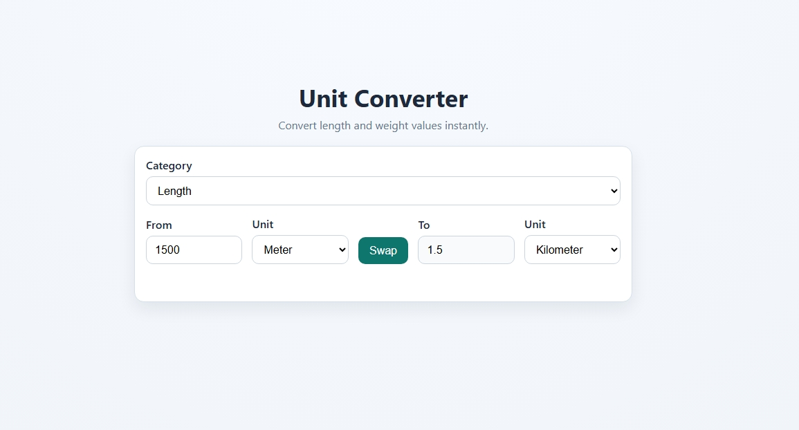

# Unit Converter

A beginner-friendly web app to convert units quickly.

## Features

- Convert **length** units: meter, kilometer, centimeter, mile, foot
- Convert **weight** units: kilogram, gram, pound, ounce
- Swap units with one click
- Instant conversion as you type
- Basic invalid-input handling

## Tech Stack

- HTML
- CSS
- JavaScript

## How to Run

1. Open the `Unit-Converter` folder.
2. Open `index.html` in your browser.

No build tools or dependencies required.

## Screenshot

Add your screenshot file here:

- `Unit-Converter/preview.jpeg`

Then this README will render it:

