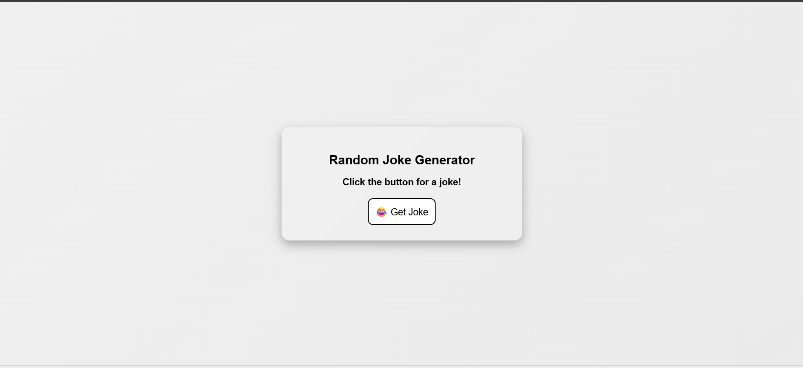
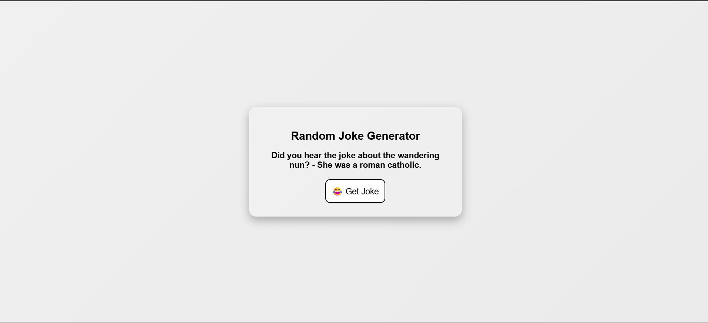

# Random Joke Generator

A tiny, beautiful Random Joke Generator built with HTML, CSS and a small client-side JavaScript fetch call.

This mini project shows a single-page app that fetches a random joke from the "Official Joke API" and displays it with a simple glassmorphism UI.

## Features

- Click a button to fetch and display a random joke (setup + punchline).
- Lightweight: no build tools or server required — just a browser.
- Responsive layout and simple animations.

## Files

- `index.html` — the single HTML page. Contains the UI and the small `fetchJoke()` script.
- `style.css` — styling (glassmorphism effect, responsive rules, and animations).

## How to run

1. Clone or download the repository to your machine.
2. Open `index.html` in a modern browser (Chrome, Edge, Firefox, Safari).

No installation is required. The app uses the public "Official Joke API" endpoint:

```
https://official-joke-api.appspot.com/random_joke
```
if you use VS code then live server will work.
here are some images for reference


## Notes & Troubleshooting

- The app fetches jokes from a public API. If the API is down or rate-limited, the button may fail silently — try refreshing the page or check the browser console for fetch errors.
- If you need to support older browsers, consider adding a small fallback or polyfill for `fetch`.

---

Enjoy the jokes! 😄